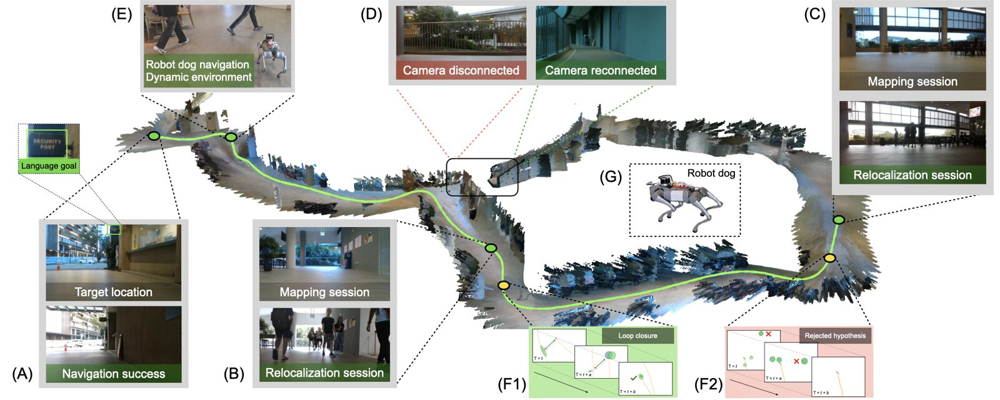

<div align="center">

# CROSS: Change-Robust Online Topological Memory for Long-Term Relocalization and Semantic Navigation

### NeurIPS 2026

Jiaming Wang, Jizhuo Chen, Diwen Liu, Atharva Ghotavadekar, Jiaxuan Da, Linh Kästner, Harold Soh

National University of Singapore

[](https://jiaming.im/CROSS/)
[](https://arxiv.org/abs/2605.02227)

[](#license)

<a href="https://jiaming.im/CROSS/"></a>

</div>

**Long-term relocalization with a probabilistic topological map, for RGB-D, stereo and monocular cameras.**

CROSS builds a map from a camera stream, saves it, and relocalizes later sessions in it, across changes in
lighting, weather, season and furniture. The map is a graph of keyframes linked by odometry and by verified loop
closures. CROSS tracks the camera pose as a Gaussian mixture over SE(3), so competing hypotheses stay alive until
the evidence separates them. Relative poses come from a learned multi-view model (VGGT-Omega, fine-tuned for CROSS)
or from feature matching with PnP on depth.

**New here? Start with the [getting-started guide](docs/GUIDE.md).** Every option is in the
[reference](docs/USAGE.md).

## Highlights

- **Fourteen shipped modes**: RGB-D, stereo or one camera, combined with external odometry (wheel, INS, a phone's
  VIO), a Basalt VIO file, CROSS's own IMU fusion, or DPVO visual odometry (no odometry input needed).
- **Multi-hypothesis tracking**: a Gaussian mixture over SE(3) with evidence-driven birth, realization and removal
  of hypotheses; a new session joins a map only when its placement is consistently supported.
- **Verified loop closure**: prior, in-pass and posterior chi-square tests at one confidence level, and pose-graph
  optimization (GTSAM) that runs in a background process on large maps.
- **Change-robust relative poses**: one forward pass of VGGT-Omega registers the current view against all
  retrieved keyframes; the metric scale comes from the stereo baseline, the depth sensor, the odometry or the map.
- **Large maps**: compact on-disk storage with lazy image loading, a retrieval index, windowed pose-graph
  optimization, a keyframe quality filter, and optional GNSS / compass anchoring.
- **Remote sessions**: the GPU work on a server, the odometry on the robot (the torch-free `cross-edge` package).
- **Benchmark**: one protocol (mapping accuracy, multi-session localization, relocalization success) on KITTI,
  OpenLORIS-Scene, ROVER and SimChange, with ORB-SLAM3, RTAB-Map, MASt3R-SLAM and VGGT-SLAM 2.0 as baselines.
- **Optional packages**: Gaussian-splatting reconstruction of a saved map ([cross_world](docs/WORLD.md)) and
  navigation on the same backbone ([cross_nav](cross_nav/README.md)).

## Installation

Requirements: Linux, an NVIDIA GPU with CUDA, [uv](https://docs.astral.sh/uv/) (the installer fetches it if
missing). The installer creates `.venv` (Python 3.11), installs PyTorch, CROSS and GTSAM, and downloads the models.

```bash
git clone https://github.com/jiaming-ai/CROSS.git
cd CROSS
bash install.sh --stereo          # RGB-D modes + the VGGT-Omega modes (the usual choice)
source .venv/bin/activate
```

| option | adds |
|---|---|
| *(none)* | the RGB-D modes with PnP (`rgbd_wheel`, `rgbd_basalt`) |
| `--stereo` | VGGT-Omega (vendored in `third_party/`) and our fine-tuned checkpoint ([Jamie-nus/VGGT-Omega-CROSS](https://huggingface.co/Jamie-nus/VGGT-Omega-CROSS)): `stereo_wheel`, `stereo_basalt`, `stereo_imu`, `rgbd_ff_*`, `mono_wheel`, `mono_basalt` |
| `--mono` | `--stereo` + DPVO (built from source; needs `nvcc` matching PyTorch's CUDA), Depth Anything 3 and LightGlue: every mode, including the DPVO modes and `mono_imu` |
| `--vggt=released` / `--vggt=both` | the released VGGT-Omega checkpoint instead of / besides ours (gated: request access at [facebook/VGGT-Omega](https://huggingface.co/facebook/VGGT-Omega), then `huggingface-cli login`) |
| `--nav`, `--nav-sim` | navigation (`cross_nav`) and its BEV heads for our checkpoint ([Jamie-nus/VGGT-Omega-CROSS](https://huggingface.co/Jamie-nus/VGGT-Omega-CROSS) `nav/`); `--nav-sim` adds the Habitat simulator |
| `--cpu`, `CUDA_VERSION=cu121` | CPU-only PyTorch (tests only: the mapping modes need a GPU); another CUDA build |

`bash install.sh --help` lists every option. Check the installation with `python -m pytest -q` (a few minutes).

## Quick start

```bash
# build a map of one session and save it
python run.py data/posed/office1-1 --mode rgbd_wheel --save-map maps/office/map.pkl
# relocalize a later session in it; write its poses in the map frame
python run.py data/posed/office1-2 --mode rgbd_wheel --load-map maps/office/map.pkl --save-poses office1-2.txt
```

`run.py` reads posed RGB-D folders, stereo folders, KITTI raw, TartanAir V2, Virtual KITTI 2, TUM RGB-D,
OpenLORIS and Record3D files. The [guide](docs/GUIDE.md) walks through this example on public data, explains the
folder layout for your own recordings, and shows the Python API.

## Modes

Choose the mode that matches your sensors with `--mode <name>` (`configs/modes/<name>.yaml`):

| sensors | external odometry | Basalt VIO file | CROSS's IMU fusion | no odometry input |
|---|---|---|---|---|
| stereo | `stereo_wheel` | `stereo_basalt` | `stereo_imu` | `stereo_dpvo` |
| RGB-D, PnP | `rgbd_wheel` | `rgbd_basalt` | | `rgbd_dpvo` |
| RGB-D, VGGT-Omega scaled by the depth | `rgbd_ff_wheel` | `rgbd_ff_basalt` | | |
| one camera | `mono_wheel` | `mono_basalt` | `mono_imu` (VGGT-Omega + IMU), `mono_vio` (DPVO + IMU) | `mono_dpvo` |

Stereo and single-camera modes run VGGT-Omega; the `rgbd_` modes without `ff` match XFeat features with LightGlue
and solve PnP on the depth image; `mono_dpvo` uses learned metric depth (Depth Anything 3). See
[USAGE.md](docs/USAGE.md#1-modes) for what each mode needs.

## Documentation

| document | content |
|---|---|
| [docs/GUIDE.md](docs/GUIDE.md) | getting started: concepts, choosing a mode, mapping and relocalizing, your own data |
| [docs/USAGE.md](docs/USAGE.md) | reference: modes, configuration, multi-session tools, GNSS, remote sessions, fine-tuning VGGT-Omega |
| [benchmark/README.md](benchmark/README.md) | running the benchmark; [PROTOCOL.md](benchmark/PROTOCOL.md) (rules) and [RESULTS.md](benchmark/RESULTS.md) (tables) |
| [edge/README.md](edge/README.md) | `cross-edge`, the robot's side of a remote session |
| [docs/WORLD.md](docs/WORLD.md), [cross_nav/README.md](cross_nav/README.md) | 3D reconstruction of a map; navigation |

## Repository layout

```
cross/             the library
  core/            system pipeline, hypotheses, loop closure, pose graph, planning, configuration
  cv/              relative pose estimation (PnP; VGGT-Omega with metric scale), features, detection
  db/              keyframe database, retrieval index, map storage
  mono/            monocular frontends (DPVO, Depth Anything 3), VGGT-Omega + IMU odometry
  imu/  geo/       IMU preintegration and scale; GNSS / compass anchoring
  remote/  rig/    split sessions (server / edge); two-phone stereo rig self-calibration
  dataloader/      dataset readers (posed and stereo folders, KITTI, TUM, OpenLORIS, R3D, ...)
  pipeline.py      modes: sensor setup x odometry source, configuration files
configs/           modes/ (one file per mode), base/ (shared pieces), overlays/ (optional layers)
run.py             run one sequence: map, relocalize, save
scripts/           map-and-relocalize harnesses, dataset converters, baselines, rig calibration, server
benchmark/         evaluation protocol, dataset preparation, job runner, results and page
edge/              cross-edge (robot side of remote sessions)
vggt_ft/           fine-tuning of VGGT-Omega (the recipe of our checkpoint)
cross_world/  cross_nav/   optional: 3D reconstruction, navigation
examples/          interactive demo, multi-session, save / load / plan
tests/             unit and integration tests (python -m pytest)
third_party/       vendored VGGT-Omega and Depth Anything 3
```

## License

CROSS's code is released under the [MIT license](LICENSE). Third-party components keep their own licenses:

- **VGGT-Omega** (`third_party/vggt-omega`, the released checkpoint, and our fine-tuned checkpoint derived from it):
  [FAIR Noncommercial Research License](third_party/vggt-omega/LICENSE). The stereo, `rgbd_ff_*` and single-camera
  modes use it.
- **Depth Anything 3**: code Apache-2.0 (`third_party/depth-anything-3`); the DA3-LARGE-1.1 weights that
  `install.sh --mono` downloads are CC BY-NC 4.0.
- **DPVO** (built by `install.sh --mono`): MIT ([patches/DPVO-LICENSE](patches/DPVO-LICENSE)).

The RGB-D modes with PnP use none of the non-commercial models.

## Citation

If you use CROSS in your research, please cite:

```bibtex
@inproceedings{wang2026cross,
  title     = {Change-Robust Online Topological Memory for Long-Term
               Relocalization and Semantic Navigation},
  author    = {Wang, Jiaming and Chen, Jizhuo and Liu, Diwen and
               Ghotavadekar, Atharva and Da, Jiaxuan and K{\"a}stner, Linh
               and Soh, Harold},
  booktitle = {Advances in Neural Information Processing Systems (NeurIPS)},
  year      = {2026},
  eprint    = {2605.02227},
  archivePrefix = {arXiv}
}
```
