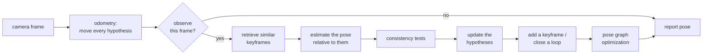

# Getting started with CROSS

This guide explains what CROSS does, how to choose a mode for your sensors, and how to build a map and find your
way back into it later. It assumes no knowledge of the code. For every flag and option, see the reference,
[USAGE.md](USAGE.md).

## 1. What CROSS does

A robot that comes back to a place it has seen before should know where it is. CROSS makes that possible across
days and seasons. It does two things:

1. **Mapping.** While the robot drives, CROSS stores a map: snapshots of the camera images (*keyframes*), where
   each was taken, and how they connect.
2. **Relocalization.** Later, in a new session, the robot starts without knowing where it is. CROSS compares what
   the camera sees with the map, figures out where the robot is, and from then on reports poses in the map's
   coordinates. It can also extend the map with the places that are new.

The hard part is that the world changes between sessions: day turns to night, furniture moves, leaves fall, people
walk by. CROSS is built to tolerate that. It keeps several guesses about the pose at once instead of trusting a
single match, and it checks every match for consistency before it uses it.

CROSS works with RGB-D cameras, stereo cameras and single cameras, with or without wheel odometry or an IMU.

## 2. The ideas in five minutes

| term | meaning |
|---|---|
| **session** | one run of the robot: one recording, from start to stop |
| **odometry** | the robot's own estimate of how it moved since the last frame (wheel encoders, a visual-inertial odometry such as ARKit or Basalt, or visual odometry from the images). Accurate over short distances, but it drifts |
| **keyframe** | a stored camera image together with its pose estimate and a compact descriptor for image search. The map is a graph of keyframes |
| **observation** | every few frames, CROSS searches the map for keyframes that look like the current image and measures the camera's pose relative to them |
| **hypothesis** | one guess of where the camera is. CROSS keeps several at once (a mixture of Gaussians) and lets evidence decide between them |
| **loop closure** | recognizing a place seen before in the same map. It adds an edge between two keyframes and corrects the drift accumulated in between |
| **pose graph optimization** | adjusts all keyframe poses so that they agree with the odometry and the loop closures |

What happens for every camera frame:



Between observations the odometry carries the pose forward, which costs almost nothing. An observation is
expensive, so CROSS makes one only when the robot has moved or turned enough.

**How the relative pose is measured.** In the stereo and single-camera modes, CROSS runs one forward pass of a
learned multi-view model, [VGGT-Omega](https://huggingface.co/facebook/VGGT-Omega), on the current image and the
retrieved keyframes together. The model returns their relative poses up to scale. The metric scale comes from
something whose size is known: the stereo baseline, the depth sensor, the odometry, or the map itself. We fine-tuned
the model for CROSS (it adds a metric-scale head and a head that predicts how much two images overlap); the
installer downloads that version. The classical RGB-D mode instead matches image features and solves the pose from
the depth image (PnP), which needs no large model.

**Why several hypotheses.** Corridors, floors of the same building and rows of shelves look alike. A single match
can be wrong. CROSS keeps the competing explanations alive until the evidence separates them. A new session joins
the map only when a placement is supported consistently over several steps and places, so one look-alike view is
not enough to teleport the robot.

## 3. Choose a mode

A *mode* names your sensors and your source of odometry in one word. Each mode is one configuration file in
`configs/modes/`, and you select it with `--mode <name>`. Find the row that matches your robot:

| your sensors | recommended mode | other options |
|---|---|---|
| stereo camera + wheel odometry (or any external odometry) | `stereo_wheel` | `stereo_dpvo` (no odometry needed) |
| stereo camera + IMU | `stereo_basalt` (needs a Basalt VIO odometry file) | `stereo_imu` (CROSS fuses the IMU itself) |
| RGB-D camera + wheel odometry | `rgbd_wheel` (no large model, fastest) | `rgbd_ff_wheel` (VGGT-Omega scaled by the depth) |
| RGB-D camera + IMU | `rgbd_basalt` | `rgbd_ff_basalt` |
| RGB-D camera only | `rgbd_dpvo` | |
| one camera + wheel odometry, or a phone's ARKit / ARCore odometry | `mono_wheel` | |
| one camera + IMU | `mono_imu` | `mono_vio`, `mono_basalt` |
| one camera only | `mono_dpvo` | |

How to read the names:

- **`stereo_` / `rgbd_` / `mono_`**: the cameras. `rgbd_ff_` runs the learned model on the colour image and takes
  the scale from the depth sensor.
- **`_wheel`**: the dataset provides the odometry (`odom_left.txt`, see section 7). Despite the name, this can be
  any odometry: wheel encoders, an INS, or a phone's ARKit.
- **`_basalt`**: the odometry comes from a file written by the Basalt stereo-inertial odometry (`odom_vio.txt`).
- **`_imu`**: CROSS fuses the IMU with its own model passes (no separate odometry needed).
- **`_vio` / `_dpvo`**: CROSS runs the DPVO visual odometry itself (`_vio`: scaled by the IMU).

Which to try first: if you have a stereo camera with any odometry, `stereo_wheel` is the most robust mode. With
only an RGB-D camera and wheel odometry, `rgbd_wheel` is light and runs fast; the VGGT-Omega modes cope better
with large changes in lighting and viewpoint.

## 4. Install

CROSS needs Linux, an NVIDIA GPU with CUDA, and about 10 GB of disk for the environment and the models. The
installer creates a virtual environment in `.venv` (Python 3.11, via [uv](https://docs.astral.sh/uv/)), installs
PyTorch and the dependencies, and downloads the model weights:

```bash
git clone https://github.com/jiaming-ai/CROSS.git
cd CROSS
bash install.sh --stereo      # RGB-D modes + the VGGT-Omega modes (stereo, rgbd_ff); the usual choice
bash install.sh --mono        # everything in --stereo + the modes with DPVO and the mono IMU modes
source .venv/bin/activate
```

`bash install.sh` alone installs only the RGB-D modes with PnP. Run all commands from the repository folder: the
model paths (`models/...`) are relative to it. `bash install.sh --help` lists every option (CPU-only, CUDA version,
navigation, Depth Anything 3).

Some models (the XFeat / LightGlue matcher and the image-retrieval network) download on first use, so the first run
needs internet access. After that, `export CROSS_HUB_OFFLINE=1` uses the cached copies.

## 5. Your first run

`run.py` processes one sequence and shows the map as it grows in a [Rerun](https://rerun.io) window:

```bash
python run.py path/to/sequence --mode stereo_wheel
```

What you see: the keyframes and their pose estimates, the trajectory of the odometry, the current hypotheses and,
when the dataset has ground truth, the true trajectory. On a server without a display add `--no-viz`. To try only
the beginning of a sequence, add `--frames 500`.

Useful options:

| option | what it does |
|---|---|
| `--frames N`, `--start N` | process N frames, starting at frame N |
| `--no-viz` | no viewer window |
| `--save-map maps/office.pkl` | save the map at the end |
| `--load-map maps/office.pkl` | start in a saved map: relocalize in it, then extend it |
| `--save-poses poses.txt` | write the camera pose of every frame (section 6) |
| `--config my.yaml`, `--set key=value` | change the configuration (section 8) |
| `--fast` | smaller images on a weaker GPU (only `stereo_basalt` and `stereo_dpvo` have a fast setting) |

Outdoors, add the outdoor settings: `--config configs/overlays/outdoor.yaml`.

## 6. Map once, relocalize later

This is what CROSS is for. Here is the full workflow on two recordings of the same office from
[OpenLORIS-Scene](https://lifelong-robotic-vision.github.io/dataset/scene.html), a public dataset recorded by a
wheeled robot with an RGB-D camera and wheel odometry. Download the "package" format from
[Hugging Face](https://huggingface.co/datasets/shixuesong/openloris-scene), then convert two sessions to CROSS's
folder layout:

```bash
python scripts/datasets/convert_openloris.py data/openloris/office1-1 data/posed/office1-1
python scripts/datasets/convert_openloris.py data/openloris/office1-2 data/posed/office1-2
```

**Session 1, mapping.** Build the map and save it:

```bash
python run.py data/posed/office1-1 --mode rgbd_wheel --save-map maps/office/map.pkl
```

The map is two things side by side: `map.pkl` (the graph: keyframe poses and edges) and the folder
`map.pkl.store/` (keyframe images and descriptors). Copy or move them together.

**Session 2, relocalization.** Start the second recording in the saved map:

```bash
python run.py data/posed/office1-2 --mode rgbd_wheel --load-map maps/office/map.pkl \
    --save-poses office1-2_poses.txt --save-map maps/office/map.pkl
```

The robot starts without knowing where it is. As soon as CROSS has placed the session in the map, the poses are
in the map's coordinates. `office1-2_poses.txt` has one line per frame from then on, in the
[TUM format](https://cvg.cit.tum.de/data/datasets/rgbd-dataset/file_formats) (`time x y z qx qy qz qw`: the camera's
position and orientation in the map); frames before the session joined the map are left out. Saving again stores
the extended map, now covering both sessions.

The same works in every mode. With the learned model on the same data (one camera of the RGB-D sensor plus the
wheel odometry), use `--mode mono_wheel`; with the depth sensor scaling the learned model, `--mode rgbd_ff_wheel`.
A map must be relocalized in with the mode family it was built with (a stereo map also accepts the `mono_wheel`,
`mono_basalt` and `mono_imu` modes, with the map's left camera), and a map built with `--fast` needs `--fast`.

**Measuring how well it works.** If both sessions have ground-truth poses, `scripts/map_and_reloc_rgbd.py` (RGB-D
and single-camera modes on these folders) and `scripts/map_and_reloc.py` (stereo folders) do both sessions and
score them. They split the second session into independent 100-frame trials, each starting without a pose, and
count a trial as successful when its final pose is within 2 m of the truth (CROSS's relocalization-success metric):

```bash
python scripts/map_and_reloc_rgbd.py --map data/posed/office1-1 --query data/posed/office1-2 \
    --out outputs/office --mode rgbd_wheel
```

`outputs/office/` then holds the map, `map_meta.json` (the map's accuracy, ATE against the ground truth) and
`reloc_summary.json` (the success rate and the error statistics). For results on many datasets and against other
systems, see the benchmark (section 9).

## 7. Using your own data

CROSS reads sequences stored as plain folders. Convert your recordings to one of these two layouts.

**One camera or RGB-D** (`rgb/` folder):

```
my_sequence/
  calib.json        {"K": [[fx, 0, cx], [0, fy, cy], [0, 0, 1]], "width": 640, "height": 480, "fps": 10}
  rgb/              000000.png, 000001.png, ...   (or .jpg; read in name order)
  depth/            optional: one depth image per frame, 16-bit PNG in millimetres or .npy in metres
  poses_left.txt    one camera pose per image (see below)
  odom_left.txt     optional: the robot's odometry, one camera pose per image (same format)
```

**Stereo** (`left/` and `right/` folders):

```
my_sequence/
  calib.json        as above, plus "T_right_in_left": the 4x4 pose of the right camera in the left camera's frame
  left/  right/     one image pair per frame, same names
  depth/            optional
  poses_left.txt    poses of the left camera
  odom_left.txt     optional
```

Details:

- **Poses** are camera-to-world transforms, one 4x4 matrix per line written as 16 numbers (row by row), in the
  OpenCV camera convention: x to the right, y down, z forward. `poses_left.txt` is the ground truth, used only to
  evaluate the result. If you have no ground truth, write your odometry poses there too.
- **Odometry.** With `odom_left.txt`, CROSS uses the steps between consecutive poses as the odometry. Without it,
  the odometry is simulated from `poses_left.txt` (noise-free, or noisy with `--snr`). `--odom-file NAME` reads
  another file of the folder, e.g. `odom_vio.txt` written by `benchmark/datasets/prepare_vio.py`.
- **Images** must be undistorted (pinhole model). In a stereo folder both cameras share `K`; the modes that run
  classical stereo matching (`stereo_dpvo`, `stereo_imu`) need rectified pairs.
- **IMU** (modes `*_imu`, `mono_vio`): `imu.txt` (`t wx wy wz ax ay az`, rad/s and m/s²) and `imu.json` (the IMU's
  pose in the camera frame and its noise); see `cross/dataloader/imu.py`.
- **GNSS** (optional, to place the map on the Earth): `gnss.txt`; see USAGE.md section 4.

`run.py` detects the layout from the folder. Converters for public datasets are in `scripts/datasets/` (OpenLORIS,
TUM RGB-D) and `benchmark/datasets/` (KITTI, ROVER, OpenLORIS stereo, NCLT). Two phones on a bar make a stereo rig
too: `scripts/rig/` calibrates it from the phones' own recordings (USAGE.md, "Calibrating a two-iPhone stereo rig").

## 8. Changing the configuration

A run's settings come from layers, each overriding the previous one:

1. the mode's file, `configs/modes/<mode>.yaml` (it includes shared pieces from `configs/base/`);
2. with `--fast`, the mode's fast overlay;
3. your files, `--config a.yaml b.yaml` (left to right);
4. single values, `--set section.key=value`.

A file of your own holds only the keys you want to change:

```yaml
# my_robot.yaml
pose_est:
  obs_max_interval_steps: 2      # observe at least every 2nd frame
mapping:
  loop_closure:
    confidence: 0.9995           # stricter loop-closure tests
```

```bash
python run.py my_sequence --mode stereo_wheel --config configs/overlays/outdoor.yaml my_robot.yaml
```

A key CROSS does not know is reported with a warning and ignored; check the spelling against `cross/core/config.py`.
The shipped overlays in `configs/overlays/` are:

| overlay | use it for |
|---|---|
| `outdoor.yaml` | outdoor scenes (larger distances) |
| `odometry_vio.yaml` | external odometry from a low-drift visual-inertial odometry (ARKit, ARCore) in a `*_wheel` mode |
| `strict_merge.yaml` | large or repetitive buildings, where a wrong relocalization costs more than a late one |
| `stereo_lowband.yaml` | remote sessions over a thin link: the left image only, at half the rate |
| `geo_anchor.yaml` | with GNSS: place the map on the Earth without moving it (USAGE.md section 4) |

**Reproducible runs.** By default, long pose-graph optimizations run in a background process so the robot never
waits for them. Results then depend slightly on the computer's speed. For experiments that must repeat exactly,
add `--reproducible`.

Some settings come with documented risks (for example the left image alone with an odometry that can run away).
CROSS then prints a warning and asks before it starts; `--accept-config-risk` answers yes for scripts.

## 9. Benchmark

`benchmark/` holds a fixed evaluation protocol: mapping accuracy (T1), localization of a later session in a stored
map (T2) and relocalization success (T3), on KITTI, OpenLORIS-Scene, ROVER and the simulated SimChange, for CROSS
and for ORB-SLAM3, RTAB-Map, MASt3R-SLAM and VGGT-SLAM 2.0. See [benchmark/README.md](../benchmark/README.md) to run
it and [benchmark/PROTOCOL.md](../benchmark/PROTOCOL.md) for the rules. The results page is
`benchmark/site/index.html`.

## 10. Using CROSS from Python

```python
import numpy as np
from cross.core.config import load_config
from cross.dataloader.auto import load_dataset
from cross.pipeline import mode_config_files, build_session
from cross.core.types import Camera
from cross.utils.lie_tensor import normalize_SE3

dataset = load_dataset("data/posed/office1-2")
camera = Camera(K=dataset.rgb_K, frame_width=dataset.rgb_width, frame_height=dataset.rgb_height)
config = load_config(*mode_config_files("rgbd", "external"))          # = configs/modes/rgbd_wheel.yaml
session = build_session("rgbd", "external", camera, config)
session.load_map("maps/office/map.pkl")                              # optional: relocalize in a saved map

to_matrix = lambda pose: normalize_SE3(pose).matrix().detach().cpu().numpy()
for i, frame in enumerate(dataset.replay_data()):  # dict: rgb, depth, delta_pose (odometry), timestamp, ...
    if i == 0:
        frame["delta_pose"] = None                  # the first frame has no motion
    session.process(frame)
    if session.localized():
        pose, _, _ = session.belief(to_matrix)      # 4x4 camera pose in the map
session.save_map("maps/office/map.pkl")
session.release()
```

Your own robot replaces the dataset with a loop over its frames: each frame is a dictionary with the colour image
`rgb` (H x W x 3, uint8), `depth` (metres) or `rgb_right` as the mode needs, the odometry step `delta_pose` (4x4,
the camera's motion since the previous frame) and `timestamp` (seconds). The stereo modes also need the stereo rig:
`build_session(..., T_right_in_left=...)`.

## 11. Running on a robot with a GPU server

The heavy part (the learned model and the map) can run on a GPU server while the robot's computer runs only its
odometry and sends images when the server will use them. The robot's side is a small package without PyTorch,
`cross-edge`, in [edge/](../edge/README.md). See USAGE.md section 6 for the simulated and real network links. The
link has no authentication or encryption: use it only on a network you trust.

## 12. Troubleshooting

| problem | what to do |
|---|---|
| no window opens / the run fails on a server | add `--no-viz` |
| `CUDA out of memory` | close other GPU programs; in `stereo_basalt` and `stereo_dpvo`, try `--fast` |
| the new session never joins the map | make sure the session revisits places that are in the map, and that the robot moves: a standing robot does not join (placements are tested at new keyframes). Check the calibration (`K`, `T_right_in_left`). A map built with `--fast` must be used with `--fast` |
| `No module named 'dpvo'` | the mode needs `bash install.sh --mono` |
| the released VGGT-Omega checkpoint does not download | it is gated: request access at [facebook/VGGT-Omega](https://huggingface.co/facebook/VGGT-Omega) and log in (`huggingface-cli login`). The default fine-tuned checkpoint is public |
| a setting has no effect | look for a `config: unknown key(s)` warning; `--set` with an unknown key stops with an error |
| CROSS asks `[y/N]` before it starts | the configuration has a documented risk; read the warning, or pass `--accept-config-risk` |
| the first run fails without internet | models download on first use; run once online, then `export CROSS_HUB_OFFLINE=1` |

## 13. Licences of the models

CROSS's own code is MIT-licensed. The learned models are not: VGGT-Omega (the vendored code in
`third_party/vggt-omega` and both checkpoints, including our fine-tuned one) is under the FAIR Noncommercial
Research License, and the Depth Anything 3 weights the `--mono` install downloads (DA3-LARGE-1.1) are under
CC BY-NC 4.0. The RGB-D modes with PnP use neither. Check these licences before any commercial use.
